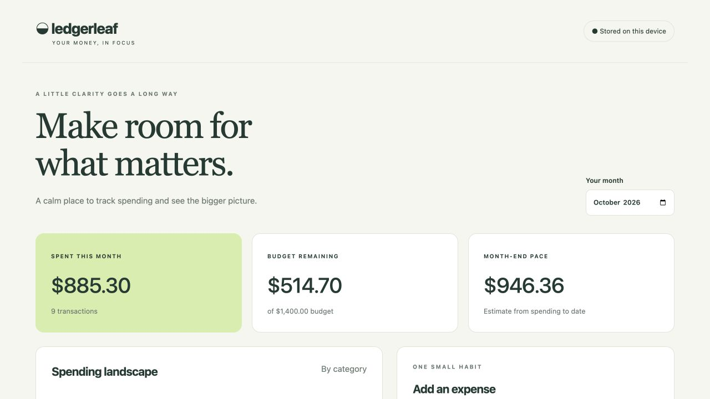

# Ledgerleaf



**Spending, with perspective.** A calm, local-first expense journal with monthly budgets, category totals, a daily spending chart, and transparent month-end pace estimates.

## Run

Python 3.11+; no third-party Python dependencies.

```sh
python3 app.py
```

Open http://127.0.0.1:8101. Optional: `python3 app.py --port 8201 --db /path/to/journal.sqlite3`.

Start with an empty journal or choose **Load sample journal**. Samples are clearly labeled and can only be seeded into an empty journal. Add an expense, set the month's budget, filter transactions, and export CSV. Delete has a confirmation prompt. All amounts are USD.

## Architecture

```text
Browser (HTML/CSS/JS) → JSON HTTP API → Ledger service → SQLite
                                      ↓
                                monthly aggregates
```

- Integer cents and Decimal validation avoid binary floating-point money errors.
- Parameterized SQL, transactional writes, an indexed date column, and independent monthly budgets.
- Date-bounded reports include category totals, a daily series, remaining budget, and current-month pace.
- Pace uses spending dated on or before today, divided by elapsed days. It is an estimate, not a prediction.
- CSV export uses proper quoting and guards against formula injection.
- Localhost binding, Host/Origin validation, JSON-only writes, bounded request sizes, and no third-party browser assets.
- A database is created at first launch and ignored by Git. Keep your own backup before modifying real data.

## API

| Method | Path | Purpose |
|---|---|---|
| GET | `/api/report?month=2026-10` | Monthly entries and aggregates |
| GET | `/api/export?month=2026-10` | CSV export |
| POST | `/api/entries` | `{day, merchant, category, amount, note}` |
| POST | `/api/delete` | `{id}` |
| POST | `/api/budget` | `{month, amount}` |
| POST | `/api/demo` | `{}`; seed only an empty journal |

Amounts in POST payloads are decimal strings; report amounts are integer cents.

## Verify

```sh
python3 -m unittest -v
```

Tests cover exact money validation, date boundaries, budget calculations, deletion, persistence, formula-safe CSV, and demo idempotence.

## Scope

A single-user local application, not an internet-hosted financial service. No login, bank integration, recurring transaction engine, import flow, or multi-currency support. The standard-library server is intentionally not a production deployment stack.

## Repository description

Local-first expense journal with exact-cent accounting, SQLite persistence, monthly budgets, and CSV export.

## Provenance

New October 2026 rebuild created with AI assistance, not a recovered original. Review and personalize before presenting your contribution. MIT licensed.
